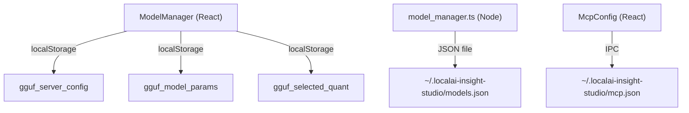

# GGUF Model Manager — Walkthrough

## What Was Built

A complete **LM Studio-inspired** local GGUF model management system natively inside the Electron chat app. Everything runs offline with no cloud dependencies.

---

## Changes Made

### Backend (Electron Main Process)

| File | Change |
|------|--------|
| [model_manager.ts](file:///c:/Users/FAHAD/Desktop/مشاريع%20AI/localai-insight-studio/src/main/model_manager.ts) | Full rewrite — GGUF registry (max 5 models, persistent JSON), `llama-server` spawning, GPU detection via `wmic`, smart suggestions calculator |
| [main.ts](file:///c:/Users/FAHAD/Desktop/مشاريع%20AI/localai-insight-studio/src/main/main.ts) | Added 11 IPC handlers: `gguf:select-file`, `gguf:register-path`, `gguf:list`, `gguf:remove`, `gguf:start-server`, `gguf:stop-server`, `gguf:smart-suggest`, `gguf:system-resources`, `gguf:generate-api-key`, `gguf:load-mcp`, `gguf:save-mcp` |
| [preload.ts](file:///c:/Users/FAHAD/Desktop/مشاريع%20AI/localai-insight-studio/src/main/preload.ts) | Exposed all 11 new channels to renderer via `contextBridge` |

### Frontend Components (`src/renderer/components/Models/`)

| Component | Purpose |
|-----------|---------|
| [ModelManager.module.css](file:///c:/Users/FAHAD/Desktop/مشاريع%20AI/localai-insight-studio/src/renderer/components/Models/ModelManager.module.css) | Single shared CSS module — all styles in one place, dark theme + neon `#00ffcc` accents |
| [ModelManager.tsx](file:///c:/Users/FAHAD/Desktop/مشاريع%20AI/localai-insight-studio/src/renderer/components/Models/ModelManager.tsx) | Top-level container with 4 tabs, localStorage persistence, system resource loading |
| [ModelDropZone.tsx](file:///c:/Users/FAHAD/Desktop/مشاريع%20AI/localai-insight-studio/src/renderer/components/Models/ModelDropZone.tsx) | Drag-and-drop + click-to-browse, `.gguf` validation, pulsing brain icon |
| [ModelList.tsx](file:///c:/Users/FAHAD/Desktop/مشاريع%20AI/localai-insight-studio/src/renderer/components/Models/ModelList.tsx) | Model cards with status dots (loading pulse / ready glow / error), size/quant badges, load/stop/delete |
| [ServerConfig.tsx](file:///c:/Users/FAHAD/Desktop/مشاريع%20AI/localai-insight-studio/src/renderer/components/Models/ServerConfig.tsx) | Full server config: RAM slider, GPU selector, VRAM, Port, context/batch/ROPE params, API key management (generate/copy/delete), 8 network toggles |
| [QuantizationSelector.tsx](file:///c:/Users/FAHAD/Desktop/مشاريع%20AI/localai-insight-studio/src/renderer/components/Models/QuantizationSelector.tsx) | 14-type grid (Q2_K → F32) with RAM estimate calculated from model file size |
| [ModelParameters.tsx](file:///c:/Users/FAHAD/Desktop/مشاريع%20AI/localai-insight-studio/src/renderer/components/Models/ModelParameters.tsx) | System prompt, Temperature/Top-K/P/min-P/Repeat sliders, context overflow, stop strings, speculative decoding full config |
| [McpConfig.tsx](file:///c:/Users/FAHAD/Desktop/مشاريع%20AI/localai-insight-studio/src/renderer/components/Models/McpConfig.tsx) | mcp.json editor with JSON validation before save, reload warning |
| [SmartSuggestBtn.tsx](file:///c:/Users/FAHAD/Desktop/مشاريع%20AI/localai-insight-studio/src/renderer/components/Models/SmartSuggestBtn.tsx) | Reusable `⚡ اقتراحات ذكية` button with loading spinner |

### App Integration

| File | Change |
|-----------|---------|
| [App.tsx](file:///c:/Users/FAHAD/Desktop/مشاريع%20AI/localai-insight-studio/src/renderer/App.tsx) | Added `Brain` nav icon, `'models'` tab, renders `<ModelManager>`, passes `activeModelName` down to `<ChatBox>` |
| [ChatBox.tsx](file:///c:/Users/FAHAD/Desktop/مشاريع%20AI/localai-insight-studio/src/renderer/components/Chat/ChatBox.tsx) | Added `activeModel?: string | null` prop, green status badge, RAG (attachments) logic, Obsidian export, and full Markdown rendering with `react-markdown` and `remark-gfm` |
| [obsidian_exporter.ts](file:///c:/Users/FAHAD/Desktop/مشاريع%20AI/localai-insight-studio/src/main/obsidian_exporter.ts) | Created — handles Markdown export to user-defined vault path |
| [rag_manager.ts](file:///c:/Users/FAHAD/Desktop/مشاريع%20AI/localai-insight-studio/src/main/rag_manager.ts) | Created — indexes local folders and files for AI context |
| [python_engine.py](file:///c:/Users/FAHAD/Desktop/مشاريع%20AI/localai-insight-studio/src/main/python_engine.py) | Created — low-level system metrics collector with 13 key indicators |


---

## Persistence Architecture



---

## Smart Suggestions Logic

The `getSmartSuggestions()` method analyzes:
- **Model file size** → determines appropriate context length (8192 for <4GB, down to 1024 for 30B+)
- **Total system RAM** → recommends RAM allocation (total - 2GB headroom)
- **GPU detection** (via `wmic`) → recommends GPU layers based on available VRAM
- **Quantization type** → adjusts temperature recommendations

---

## Build Verification

```
> webpack --config webpack.config.js

asset main.js 47.8 KiB [emitted]
webpack 5.105.2 compiled successfully in 9283 ms
```

✅ **0 TypeScript errors, 0 build warnings**

---

## How to Use

1. Click the **🧠 Brain icon** in the sidebar
2. **Library tab** → Drag a `.gguf` file or click the drop zone → the model appears in the list
3. Click **تحميل** → starts `llama-server` in the background (requires `llama-server` in PATH)
4. **Server tab** → Configure RAM, GPU layers, context length, API keys, network toggles
5. Click **⚡ اقتراحات ذكية** → auto-fills settings based on your hardware
6. **Parameters tab** → Set system prompt, sampling parameters, speculative decoding
7. **MCP tab** → Edit and save `mcp.json` for tool servers
8. **Chat tab** → The active model name appears as a green badge in the header. Markdown responses are beautifully rendered.
9. **RAG (Local Context)** → Click the 📎 icon to attach a folder/file. Use it to ask questions about your code.
10. **Obsidian Export** → Click the 📖 icon to export your session to your vault.


> **Note:** `llama-server` must be installed from [llama.cpp](https://github.com/ggerganov/llama.cpp) and in your `PATH` for server start/stop to work. If not available, all UI interactions still work — only the IPC call returns a graceful error shown as a status dot.
